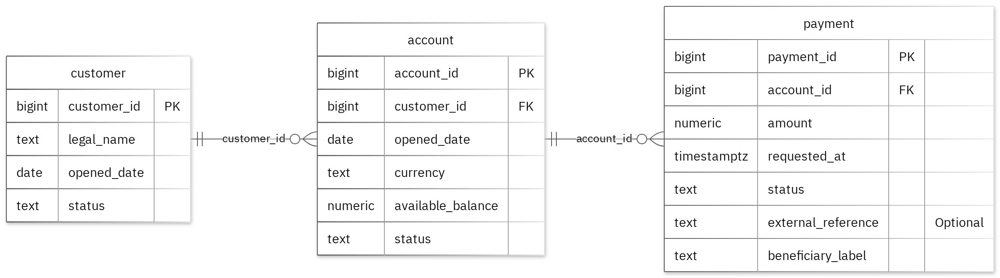

# MIT 8103 Advanced Database Systems

**Bank / Fintech Platform** · Goodnews Ukaegbu · Student ID 301923986

## Case study

My case study is Bank / Fintech Platform. I designed the database for customers managing accounts and initiating payments and operations staff reviewing and reconciling payment activity, with separate tables named customer, account and payment. It supports these operations: open a customer account; initiate and record a payment; review payments by account and time period.

## Portfolio 1: Database Design and Modelling

I organised the relational design into 3 tables with 3 customers, 4 accounts and 10 payments of sample data. Primary keys identify records, foreign keys preserve the links, and checks enforce the stated business rules, including the allowed status values and three-letter currency codes. A non-null external_reference must be unique, enforced by a partial unique index where external_reference is not null. The foreign-key columns are indexed, because PostgreSQL does not do this automatically. The normalisation walk-through starts from unnormalised records, shows the update, insertion and deletion anomalies of the 1NF form, reaches 3NF, and a lossless-join check rebuilds all 10 rows exactly. All 28 deliberately invalid inserts were rejected at the expected constraint without changing the valid sample rows.

Figure 1. Tables, keys and relationships. PK: primary key; FK: foreign key; UK: unique value.

<!-- PAGE BREAK -->

## Portfolio 2: Query Processing and Optimisation

I ran three SQL queries against the sample records: a three-table join (10 rows), the case's review of payments by account and time period (3 rows, answered directly by the composite index from Portfolio 1), and activity per account with a LEFT JOIN that keeps the account without payments. For the index comparison, I used 50,000 separate performance rows and five measured runs per phase. For a one-day requested_at range, the median time changed from 1.560 ms to 0.098 ms with a B-tree index. For one account over a quarter, an index on requested_at alone helped little (1.723 ms to 0.947 ms, and more buffer reads than a full scan), while a composite (account_id, requested_at) index brought it to 0.022 ms. Every phase returned the same records, checked by row count and an MD5 fingerprint. These timings apply to these lookups and this environment.

## Portfolio 3: Transactions and Concurrency

I used a temporary counter on account to test COMMIT, ROLLBACK and READ COMMITTED isolation. The uncommitted update remained hidden from the other session, and ROLLBACK restored the earlier committed value. Without locking, two increments left the counter at 2. With SELECT FOR UPDATE, Session B waited for Session A and the final value was 3. I then repeated the problem with two 400.00 payments from an account holding 640.00. Read-then-write under READ COMMITTED paid out 800.00 while the balance fell only to 240.00. SELECT FOR UPDATE made the second session wait and reject its payment, and REPEATABLE READ stopped it with a serialization failure (40001), after which a retry rejected it. A cleanup script removes the helper column and test payments, so the case's original business fields stay unchanged.

## Portfolio 4: NoSQL and Advanced Data Models

I used payment_event for the case's event documents. MongoDB inserted 18 events built from the same sample payments: a request for every payment, a settlement for each posted payment and a failure for the failed one, with amounts stored as Decimal128. Five queries returned the expected results, and the settled totals per currency matched the PostgreSQL totals. explain() showed both indexes in use, examining only the documents returned instead of all 18. Validation rejected an invalid date type, an unknown event type, a text amount and a missing channel (code 121) and a duplicate event ID (11000). Embedded snapshots keep related details with an event, while the details field can differ by event type. These are fictional events; PostgreSQL continues to enforce its relational rules.

## Portfolio 5: Distributed and Cloud Database Exercise

I proposed three MongoDB replica members across separate failure zones. The discussion covers primary elections, majority acknowledgement, secondary lag and sharding trade-offs for payment_event. Replication supports availability, while backups address recovery. PostgreSQL needs its own availability plan. No cloud service was provisioned, but I ran the replica-set pattern locally with three mongod processes on one machine: after the primary was killed, a new primary was elected in about 9 seconds, majority writes continued with two of three members, the restarted member caught up, and a single remaining member refused writes because it had no majority. Because all three members shared one machine, this shows the mechanism, not real high availability.

## Repository and evidence

https://github.com/Oziichukwu/Ukaegbu_Goodnews_301923986

The portfolio folders contain the SQL and JavaScript, explanations, query plans, result tables, screenshots and the raw output of every run (evidence folders). run_all.sh rebuilds every exercise from scratch.

## Individual reflection

I kept customer, account, payment in separate tables so their details could be maintained without repeating them in every related record. A non-null external_reference must be unique, enforced by a partial unique index where external_reference is not null. The constraint tests check this alongside the required values and record links. One issue illustrated by the two-session exercise is that both sessions can read the same value before either update is committed. Locking the row before reading preserves both increments. The index comparison also shows why I need to check the execution plan as well as the final answer: the same result can require different amounts of database work.

## AI-use declaration

I used GitHub Copilot and the portfolio generator to help prepare the database model, scripts and explanations. The generator ran the PostgreSQL and MongoDB exercises, checked their outputs and captured the result images.  I remain responsible for checking and explaining the submitted work.

## References

- [PostgreSQL: constraints](https://www.postgresql.org/docs/17/ddl-constraints.html)
- [PostgreSQL: EXPLAIN](https://www.postgresql.org/docs/17/using-explain.html)
- [PostgreSQL: isolation](https://www.postgresql.org/docs/17/transaction-iso.html)
- [PostgreSQL: row locks](https://www.postgresql.org/docs/17/explicit-locking.html)
- [MongoDB: data modelling](https://www.mongodb.com/docs/manual/data-modeling/)
- [MongoDB: replication](https://www.mongodb.com/docs/manual/replication/)
- [MongoDB: sharding](https://www.mongodb.com/docs/manual/sharding/)
- [Mermaid: ER diagrams](https://mermaid.js.org/syntax/entityRelationshipDiagram.html)

