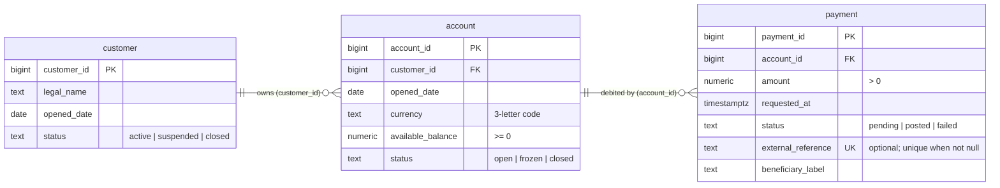

# Bank / Fintech Platform — ER diagram

**Legend.** PK: primary key. FK: foreign key to another table. UK: unique value — here `external_reference` is unique only when it is not null (partial unique index `payment_reference_idempotent`). Quoted text after a field shows its CHECK rule or allowed values. The crow's-foot ends read: one customer owns zero or many accounts; one account is debited by zero or many payments; every account and payment has exactly one parent.

There are no composite keys in this design. Supporting indexes (`idx_account_customer_id`, `idx_payment_account_requested_at`) are listed in the [design](Ukaegbu_Goodnews_301923986_P1_Design.md#indexes).

[Diagram image](../images/Ukaegbu_Goodnews_301923986_ERDiagram.png)
