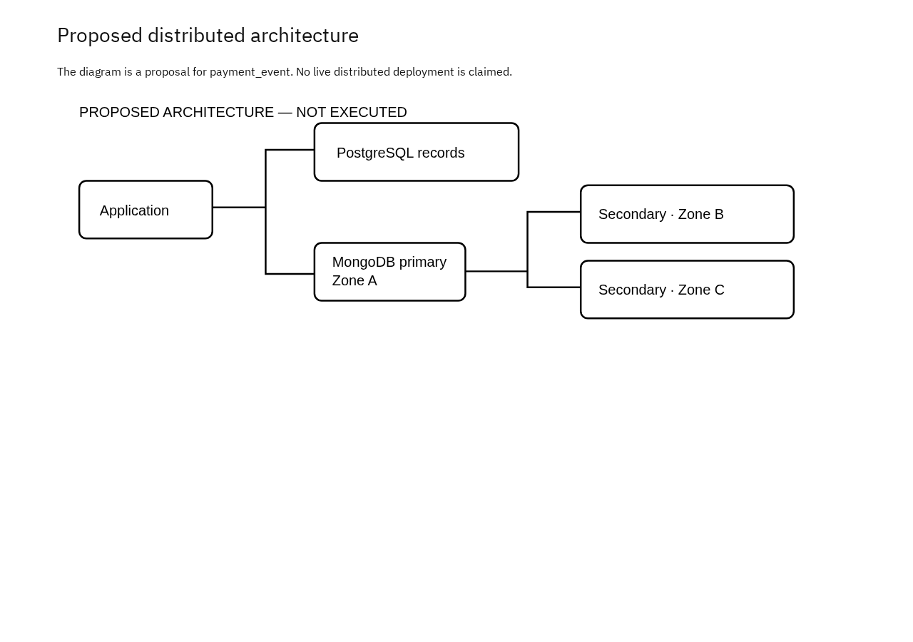

# Portfolio 5 — Distributed and Cloud Database Exercise

This is the proposed distributed design for the Bank / Fintech Platform case study, followed by a live demonstration of the replication and election behaviour it relies on, run on one machine.

## Case and proposed deployment

Bank / Fintech Platform keeps its relational records in PostgreSQL. MongoDB stores payment_event: Store synthetic payment lifecycle events with the payment identifier, event time, event type, and embedded account and customer snapshots for event-oriented review. Proposed deployment: the application connects to a three-member MongoDB replica set across three availability zones in one region. PostgreSQL also needs its own managed high-availability configuration. These are separate databases; a MongoDB replica set does not replicate PostgreSQL.

## Replication and availability

One primary accepts writes. Two secondaries copy the oplog asynchronously. If the primary fails, eligible members can elect a replacement when a voting majority is available. Writes can pause during election. A partition without a majority cannot elect a primary. Three containers on one computer would not protect against loss of that computer.

## Consistency and the case

For payment_event, a proposed client policy is majority write concern with a finite timeout, primary reads and majority read concern where committed data is required. Secondary reads can lag. Application retries need an idempotency key so the same event is not recorded twice. PostgreSQL constraints remain authoritative for Every account must reference an existing customer through customer_id. These settings do not create an atomic transaction across PostgreSQL and MongoDB. An outbox and retrying consumer would be a separate implementation.

## Sharding trade-off

Sharding partitions documents; replication copies them for availability. The small sample in this portfolio does not need sharding. If payment_event becomes large, evaluate a high-cardinality source-record identifier as a possible hashed shard key against actual query and write patterns. A time-only increasing key can concentrate new writes, while a hashed key can make time-range queries contact multiple shards. Validate distribution and query plans before choosing a key.

## Cloud deployment and recovery

A real deployment would use private networking, authentication, least-privilege roles, TLS, monitoring and tested backups. Replication also copies accidental deletions, so it does not replace backups. Availability zones do not provide regional disaster recovery. No cloud service was provisioned, and no sharding or backup-recovery experiment was run. The replication and failover behaviour was tested locally, as described next.

## Live demonstration: replication and failover

[`P5_ReplicaSetDemo.sh`](Ukaegbu_Goodnews_301923986_P5_ReplicaSetDemo.sh) starts three `mongod` processes (ports 27101–27103) as replica set `rs0` and tests the behaviour the design depends on. Results from [evidence/…_P5_ReplicaSetDemo.txt](evidence/Ukaegbu_Goodnews_301923986_P5_ReplicaSetDemo.txt) (MongoDB 8.0.23):

| Step | What was done | Observed |
| --- | --- | --- |
| 1 | Initiate the three-member set | 27101 PRIMARY, 27102 and 27103 SECONDARY, all health=1 |
| 2 | Insert 3 payment_event documents with `w: "majority"` | Acknowledged; each member, read directly, held 3 documents |
| 3 | Check replication lag | Both secondaries 0 s behind the primary |
| 4 | Crash the primary with `kill -9` | 27103 elected primary after **9,099 ms** (term 1 → 2, reason `electionTimeout`; timeout setting 10,000 ms) |
| 5 | Write with `w: "majority"` while one member is down | Acknowledged: 2 of 3 members are still a majority |
| 6 | Restart the crashed member | 27101 rejoined as SECONDARY and caught up to 4 documents |
| 7 | Stop two members so only one of three votes remains | After 12 s no primary was elected; the last member stayed SECONDARY and refused a write with code **10107 (NotWritablePrimary)** |
| 8 | Restart the two members | A primary was elected again; all three members held the same 4 documents |

This confirms the points made above: a majority-acknowledged write survives the loss of the primary, writes pause during an election (here about 9 s with default settings), a member that was down catches up from the oplog, and a minority partition cannot elect a primary or accept writes.

All three members ran on **one computer**, so this demonstrates replication and elections working — it is not high availability. As noted above, losing that computer would lose all three members; the proposed deployment places them in three availability zones.

Run it with `bash Ukaegbu_Goodnews_301923986_P5_ReplicaSetDemo.sh` (needs `mongod` and `mongosh` on PATH; it uses a temporary data directory and removes it afterwards), or `./run_all.sh --with-replica-set` from the repository root.

[Failover evidence](screenshots/Ukaegbu_Goodnews_301923986_P5_ReplicaSetFailover.png)

## References

- [MongoDB: replication](https://www.mongodb.com/docs/manual/replication/)
- [MongoDB: sharding](https://www.mongodb.com/docs/manual/sharding/)
- [MongoDB: replica set elections](https://www.mongodb.com/docs/manual/core/replica-set-elections/)

The proposed architecture diagram shows the cloud deployment, which was not provisioned; the live demonstration above ran the same three-member pattern on one machine.
